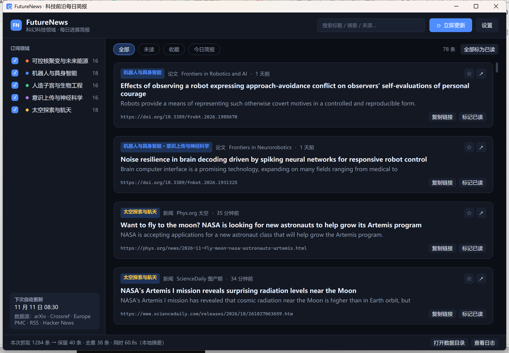
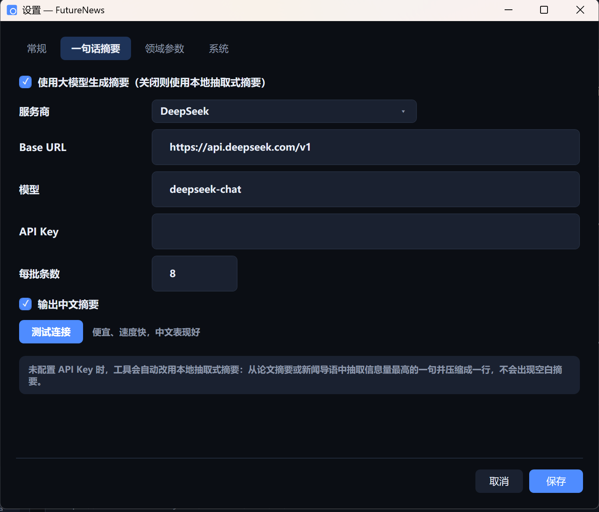

# FutureNews · 科技前沿每日简报

> 每天自动把全世界与你关心的「科幻级」技术相关的新论文和新闻，浓缩成一句中文摘要 + 原文链接。

FutureNews 是一个常驻托盘的 Windows 桌面小工具（WPF / .NET 8）。它按你订阅的领域，从 arXiv、Crossref、Europe PMC、科技媒体 RSS 和 Hacker News 抓取过去几天的内容，做相关性打分、近重复去重和每日配额控制，再用大模型（或本地离线算法）为每条内容生成一句话中文摘要。点一下就能跳到原文。



---

## 目录

- [内置领域](#内置领域)
- [功能一览](#功能一览)
- [系统要求](#系统要求)
- [快速开始](#快速开始)
- [命令行参数](#命令行参数)
- [一句话摘要（LLM）](#一句话摘要llm)
- [定时更新](#定时更新)
- [数据与日志](#数据与日志)
- [抓取与筛选逻辑](#抓取与筛选逻辑)
- [打包发布](#打包发布)
- [项目结构](#项目结构)
- [常见问题](#常见问题)

---

## 内置领域

| Id | 名称 | 覆盖内容 |
| --- | --- | --- |
| `fusion` | 可控核聚变与未来能源 | 托卡马克/仿星器、惯性约束、超导磁体、聚变堆材料、先进裂变与储能 |
| `robotics` | 机器人与具身智能 | 人形机器人、灵巧手、具身智能、运动控制、自动驾驶、群体机器人 |
| `bio` | 人造子宫与生物工程 | 人造子宫、胎盘/胚胎体外培养、类器官、基因编辑、合成生物学 |
| `neuro` | 意识上传与神经科学 | 脑机接口、神经解码、全脑成像、连接组、记忆与意识研究 |
| `space` | 太空探索与航天 | 火箭复用、深空探测、月球/火星基地、在轨制造、空间站与商业航天 |

每个领域都可以单独设置相关度阈值、每日条数上限，以及追加/排除关键词（设置 → 领域参数）。

## 功能一览

- **多来源聚合**：arXiv、Crossref、Europe PMC、按领域筛选的 RSS、Hacker News（Algolia）。
- **相关性打分**：标题/摘要关键词加权 + 领域级阈值；容易误判的词（如 `fusion`、`plasma`、`reactor`）必须与领域内其他词同时出现才算命中。
- **去重**：URL 精确去重 + 归一化标题匹配 + 64 位 SimHash 近重复检测（跨天保留 45 天记忆）。
- **一句话摘要**：任意 OpenAI 兼容接口（DeepSeek、通义千问、Kimi、智谱、硅基流动、OpenAI、Ollama、自定义）；没有 Key 时自动改用本地抽取式摘要，不会出现空摘要（但沿用原文语言，配置 LLM 后才输出中文）。
- **每日配额**：每个领域每日上限 + 全局每日上限，按分数从高到低录取。
- **定时更新**：托盘内置每日定时器，也可以注册 Windows 计划任务（程序没运行也能更新）。
- **托盘常驻**：关闭窗口只是隐藏到托盘；更新完成可弹气泡通知。
- **中文深色界面**：搜索、全部/未读/收藏/今日简报筛选、一键全部标记已读、复制链接、打开原文。

设置界面：



## 系统要求

- Windows 10 1809 及以上 / Windows 11
- [.NET 8 Desktop Runtime](https://dotnet.microsoft.com/download/dotnet/8.0)（若使用自包含发布则无需安装）
- 可访问外网（arXiv / Crossref / Europe PMC / RSS / Hacker News）
- 可选：一个大模型 API Key（不配也能用）

## 快速开始

### 构建

```powershell
# 在仓库根目录
dotnet build FutureNews.sln -c Release

# 直接运行
dotnet run --project src/FutureNews.App

# 或运行构建产物
.\src\FutureNews.App\bin\Release\net8.0-windows\FutureNews.exe
```

### 首次使用

1. 左侧勾选你关心的领域（默认全部勾选）。
2. 打开 **设置 → 常规**，确认更新时间（默认 08:30）、回溯天数（默认 3 天）、每日上限（默认每领域 8 条 / 全局 40 条）。
3. 打开 **设置 → 一句话摘要**，选择服务商、填入 API Key，点「测试连接」。
4. 点右上角 **立即更新**，等待状态栏显示抓取结果。

> 首次抓取通常需要 30–90 秒（arXiv 有 3 秒/请求的礼貌限速）。第二次开始会明显变快，因为重复内容会被去重跳过。

## 命令行参数

程序是 GUI 应用（`WinExe`），但支持无界面运行，便于脚本和计划任务调用。

| 参数 | 说明 |
| --- | --- |
| `--fetch` | 无界面执行一次抓取后退出（配合计划任务） |
| `--console` | 把进度和结果打印到调用它的控制台（需与 `--fetch` 同用） |
| `--silent` | 不弹托盘通知（计划任务里建议加上） |
| `--report <路径>` | 把本次简报写成 UTF-8 文本文件 |
| `--enable all` 或 `--enable fusion,space` | 临时指定本次启用的领域（会写回订阅设置） |
| `--settings` | 启动后直接打开设置窗口 |
| `--tray` | 只驻留托盘，不显示主窗口（开机自启用） |

示例：

```powershell
FutureNews.exe --fetch --console --report .\digest.txt
FutureNews.exe --fetch --silent --enable fusion,robotics
```

> `WinExe` 不会阻塞 PowerShell。脚本里读取 `--report` 生成的文件前，请等待进程结束（例如 `Start-Process -Wait`）。

## 一句话摘要（LLM）

摘要引擎使用 **OpenAI Chat Completions 兼容协议**，任何提供 `/chat/completions` 的服务都能用。

| 预设 | Base URL | 默认模型 |
| --- | --- | --- |
| DeepSeek | `https://api.deepseek.com/v1` | `deepseek-chat` |
| 阿里云百炼（通义千问） | `https://dashscope.aliyuncs.com/compatible-mode/v1` | `qwen-plus` |
| 月之暗面 Kimi | `https://api.moonshot.cn/v1` | `moonshot-v1-32k` |
| 智谱 GLM | `https://open.bigmodel.cn/api/paas/v4` | `glm-4-flash` |
| SiliconFlow | `https://api.siliconflow.cn/v1` | `Qwen/Qwen2.5-7B-Instruct` |
| OpenAI | `https://api.openai.com/v1` | `gpt-4o-mini` |
| Ollama（本地） | `http://localhost:11434/v1` | `qwen2.5:7b` |
| 自定义 | 自行填写 | 自行填写 |

说明：

- **API Key 用 Windows DPAPI（当前用户）加密后存进本地数据库**，不会明文落盘；换 Windows 账户后需要重新填写。
- 「每批条数」决定一次请求总结多少条，默认 8。批量越大越省 token，但单次耗时更长。
- 关闭「使用大模型生成摘要」、或没有填写 Key、或调用失败时，会**自动降级为本地抽取式摘要**：从论文摘要/新闻导语中挑信息量最高的一句并压缩成一行（沿用原文语言，多数为英文）。整个过程不需要联网调用模型。
- 状态栏会显示本次摘要来源，例如「（本地摘要）」或 LLM 条数；无界面模式会打印 `摘要：LLM N 条，本地抽取 M 条`。
- 请求超时默认 60 秒（对应 `AppSettings.Llm.TimeoutSeconds`）。

## 定时更新

### 1. 托盘内置定时器

设置 → 常规 → 勾选「启用内置定时更新（托盘常驻）」。程序在托盘里运行时，每天到点自动抓取，并按通知设置弹气泡。

> 关闭主窗口不会退出程序，只是隐藏到托盘。真正退出请用托盘图标右键 → 退出。

### 2. Windows 计划任务（推荐同时启用）

设置 → 系统 → 「注册」。它会创建名为 `FutureNews Daily Update` 的计划任务，在设定时间执行：

```text
"<程序路径>\FutureNews.exe" --fetch --silent
```

即使托盘程序没有运行，系统也会按时抓取。等价的手动命令：

```powershell
schtasks /Create /TN "FutureNews Daily Update" /TR "\"C:\path\to\FutureNews.exe\" --fetch --silent" /SC DAILY /ST 08:30 /F /RL LIMITED
schtasks /Delete /TN "FutureNews Daily Update" /F
```

修改更新时间后需要重新注册（设置 → 系统 → 取消注册 → 注册）。

### 3. 开机自启

设置 → 常规 → 「开机自动启动」。会在当前用户的启动文件夹写入一个 `FutureNews.cmd`，内容等价于：

```bat
start "" "C:\path\to\FutureNews.exe" --tray
```

即静默驻留托盘，不弹主窗口。

## 数据与日志

所有数据都在 `%APPDATA%\FutureNews\`：

| 文件 | 内容 |
| --- | --- |
| `futurenews.db` | SQLite：文章、订阅、设置、来源健康度（API Key 经 DPAPI 加密） |
| `futurenews.log` | 运行日志（启动、抓取、异常） |
| `logs\` | 预留日志目录 |

- 想完全重置：退出程序后删除整个 `%APPDATA%\FutureNews` 文件夹。
- 设置 → 系统 → 「打开数据目录 / 查看日志」可以直接定位。
- 「清空本地历史」只删除文章，不删除设置和 API Key。

## 抓取与筛选逻辑

1. **抓取**：对每个启用领域，并行请求各来源（`Limit` 每个来源每次 30 条，时间窗 = 回溯天数）。
2. **合并**：按 URL 合并，保留信息更完整的元数据（摘要、作者、期刊）。
3. **打分**：领域关键词按核心/强/支持三档加权，命中多个领域时同时归入多个领域；低于阈值或命中排除词的直接丢弃。
4. **去重**：URL、归一化标题、SimHash（汉明距离 ≤ 6）三重判断，并和最近 45 天见过的内容比对。
5. **配额**：按分数降序录取，直到达到每领域上限和全局上限。
6. **摘要**：批量调用 LLM；失败则本地抽取。
7. **落库**：写入 SQLite，并清理超过保留天数（默认 30 天）的旧文章。

来源注意事项：

- **arXiv**：官方 API 有严格限速（约 3 秒/请求），日期过滤在客户端完成。抓取慢是正常的。
- **Crossref**：会返回少量「未来日期」的记录，程序会按时间窗过滤。
- **Europe PMC**：日期范围要放在查询括号外，已做兼容。
- **OpenAlex**：**默认关闭**。没有个人 API Key 时，同一出口 IP 共享很小的每日额度，很容易返回 429。需要时可在设置里打开并填写 Key。
- **RSS / Hacker News**：只取标题、导语和链接，正文请点原文。

## 打包发布

```powershell
# 框架依赖版（体积小，目标机器需装 .NET 8 Desktop Runtime）
powershell -ExecutionPolicy Bypass -File scripts\publish.ps1

# 自包含单文件版（体积大，目标机器无需安装 .NET）
powershell -ExecutionPolicy Bypass -File scripts\publish.ps1 -SelfContained -SingleFile -Zip
```

输出在 `publish\FutureNews-win-x64\`，主程序为 `FutureNews.exe`。加 `-Zip` 会额外生成压缩包，方便分发。

也可以直接调用 SDK：

```powershell
dotnet publish src\FutureNews.App\FutureNews.App.csproj -c Release -r win-x64 --self-contained false -o publish\FutureNews-win-x64
```

> 发布版仍然使用 `%APPDATA%\FutureNews` 作为数据目录。把程序放到新路径后，计划任务里记录的旧路径需要重新注册。

## 项目结构

```text
FutureNews.sln
src/
  FutureNews.Core/                 业务逻辑（无 UI 依赖）
    Sources/                       arXiv / Crossref / Europe PMC / RSS / Hacker News / OpenAlex
    Processing/                    相关性打分、SimHash
    Summarizing/                   LLM 客户端、摘要服务、离线抽取
    Storage/                       SQLite 仓库、设置存储（DPAPI）
    Pipeline/DigestPipeline.cs     一次完整抓取的编排
    Scheduling/DailyScheduler.cs   内置每日定时器
    Topics/TopicCatalog.cs         五个领域的词表、arXiv 分类、RSS 源
  FutureNews.App/                  WPF 界面
    Views/SettingsWindow.xaml      设置（常规 / 一句话摘要 / 领域参数 / 系统）
    Tray/TrayIconManager.cs        托盘图标与通知
    Scheduling/TaskSchedulerRegistrar.cs  计划任务注册
    Theme/                         深色主题与控件模板
scripts/publish.ps1                发布脚本
docs/                              截图
```

## 常见问题

**抓不到内容 / 条数很少**
检查领域是否勾选、相关度阈值是否过高（默认 0.30）、回溯天数是否太短；再看状态栏或 `futurenews.log` 里是否有来源报错。首次运行需要多等一会儿。

**状态栏提示某个来源失败**
多为网络问题或对方限流。来源健康度会记录失败，第二天自动重试；不会影响其他来源。

**摘要显示「本地摘要」而不是 LLM**
说明没有配置 Key、Key 无效，或模型接口报错。到设置 → 一句话摘要点「测试连接」，状态栏和日志里会给出具体原因。

**控制台中文乱码**
程序在 `--console` 模式下会切换到 UTF-8（代码页 65001）。如果仍然乱码，先在终端执行 `chcp 65001`。

**计划任务没有执行**
确认任务名 `FutureNews Daily Update` 存在、程序路径没有移动、电脑在设定时间处于开机状态。也可以手动运行 `FutureNews.exe --fetch --console` 验证。

**关闭窗口后程序还在**
这是设计行为（托盘常驻）。右键托盘图标 → 退出即可完全关闭。

## 说明

- 所有内容来自各平台的公开 API 与 RSS，请遵守其使用条款与限速要求；抓取频率已做保守设置。
- 一句话摘要由模型自动生成，可能存在偏差或遗漏，请以原文为准。
- 本项目仅用于个人学习与信息聚合，不存储、不分发第三方全文。
